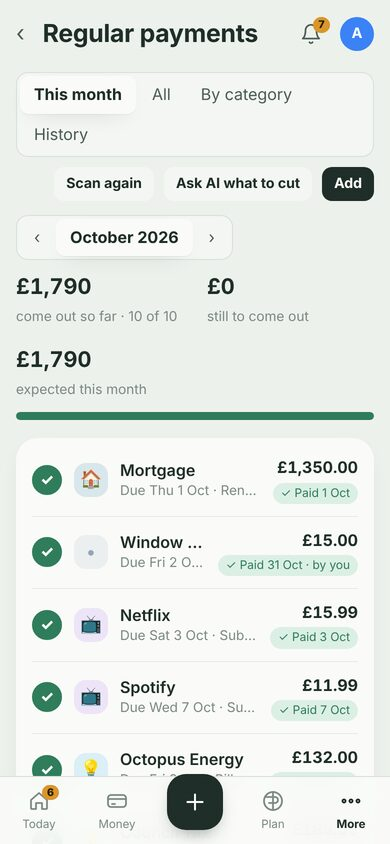

<b>Household money, handled.</b> 
A self-hosted finance manager for individuals and families: on your Mac, Windows or Linux computer, a household server, Docker or Home Assistant, with apps for iPhone, iPad and Android, and a local AI that knows your numbers.

<a href="https://github.com/shotgn16/hearth/releases/latest"><b>Download</b></a> ·
<a href="docs/install/README.md"><b>Install guide</b></a> ·
<a href="https://my.home-assistant.io/redirect/supervisor_add_addon_repository/?repository_url=https%3A%2F%2Fgithub.com%2Fshotgn16%2Fhearth">Add to Home Assistant</a>

Hearth takes the admin of money out of your head. Transactions arrive from your bank, get cleaned up, categorised and checked against your budgets on their own. You only hear about the few things that genuinely need a decision.

Everything stays on your own equipment — transactions, budgets, calendar copies and AI conversations live in one local database on your computer, server or Home Assistant. Bank, mailbox and calendar logins and receipt files are encrypted on disk.

## What it does

| | |
|---|---|
| **Today** — one sentence answers "am I OK?" ("£2,913 free until payday on Fri 27 Nov"), with an 8-week balance forecast, what's due, budgets and goals. | **Needs attention** — the only list you have to look at. Every answer teaches Hearth, so it shrinks over time. |
| **Jot it down** — type `Ella's dentist £60 next Tue` or snap a receipt. Hearth works out the amount, date, category and person and files it. | **Ask Hearth** — chat with your own Ollama model. It looks up real figures and prepares budgets, goals and price watches you confirm with a tap. |
| **Spreadsheet power** — editable transaction grid, bulk edits, saved views, a year planner where actuals fill themselves in, pivot reports, CSV export. | **Forecasts** — next 8 weeks, 2 years and 5 years, built from your regular payments, seasonality, plans and event budgets. |
| **The whole household** — separate logins; budgets and targets that are shared, one person's own, or for the kids. | **Regular payments tracker** — subscriptions and bills found automatically; set payment dates, see what's come out this month, ongoing / cancelling / ended with last payments, a 12-month history grid. |
| **Calendars** — your HA calendars, Outlook / Microsoft 365 via sign-in, or iCal links with budgets and real costs on events. | **Home Assistant** (optional): notifications to your phones, sensors for dashboards, events and service calls from workflows. |
| **Unexpected costs & work expenses** — flag unplanned costs and see what to put aside; track work expenses from to claim → claimed → paid back. | **Price watch** — PriceRunner or any shop; tells you when it's a good time to buy. |
| **Email receipts** — Hearth watches your mailbox (Gmail, iCloud, Outlook / Microsoft 365, Exchange or any IMAP), reads receipts and PDF bills, matches each to the right bill, payment and account, and waits for your approval. | **Bank sync** — any SimpleFIN feed (Synci for UK banks, superFin, SimpleFIN Bridge) or any JSON feed, plus CSV/OFX/QIF import for years of history. |
| **Workflows** — automatic rules for categories, tags, flags, notifications and Home Assistant. | **Secure by default** — secrets and receipt files encrypted at rest, passphrase-locked backups, hashed sign-ins, a strict browser lock-down. |

## Install

| | |
|---|---|
| **Mac, Windows, Linux** | Download the installer from the [downloads page](https://github.com/shotgn16/hearth/releases/latest) and open it. A setup wizard runs Hearth just for you, for you and your phone, as an always-on household server, in Docker or in Home Assistant. Everything Hearth needs is included. |
| **iPhone, iPad, Android** | The Hearth app connects to your Hearth with one QR code scan. |
| **Server without a screen** | The *Hearth Server* download installs a background service with one command. |
| **Docker** | `docker run -d -p 8484:8484 -v ./data:/data ghcr.io/shotgn16/hearth` |
| **Home Assistant** | Click **Add to Home Assistant** above, install **Hearth** from the add-on store, and start it. |

**[Installing Hearth: step-by-step guides](docs/install/README.md)** for [macOS](docs/install/macos.md) · [Windows](docs/install/windows.md) · [Linux](docs/install/linux.md) · [phones and tablets](docs/install/phones-and-tablets.md) · [servers](docs/install/server-only.md) · [Docker](docs/standalone-docker.md) · [Home Assistant](docs/install/home-assistant.md)

Then follow [Getting started](docs/getting-started.md).

## Documentation

- [Installing Hearth](docs/install/README.md): [macOS](docs/install/macos.md), [Windows](docs/install/windows.md), [Linux](docs/install/linux.md), [phones & tablets](docs/install/phones-and-tablets.md), [server without a desktop](docs/install/server-only.md), [Home Assistant](docs/install/home-assistant.md)
- [Getting started](docs/getting-started.md)
- [Connecting your bank and importing history](docs/bank-and-import.md)
- [Everyday use: Today, Needs attention, Jot, Money, Plan, Insights](docs/everyday-use.md)
- [Regular payments: the subscription and bill tracker](docs/regular-payments.md)
- [Email receipts](docs/email-receipts.md)
- [Unexpected costs and work expenses](docs/unexpected-and-work.md)
- [Households: people, shared and individual budgets](docs/household.md)
- [Local AI (Ollama)](docs/local-ai.md)
- [Home Assistant integration](docs/home-assistant.md)
- [Workflows and notifications](docs/workflows.md)
- [Calendars and event costs](docs/calendars-and-events.md)
- [Price watch](docs/price-watch.md)
- [Run it with Docker (without Home Assistant)](docs/standalone-docker.md)
- [Privacy, security and backups](docs/privacy-and-security.md)
- [Troubleshooting & FAQ](docs/faq.md)
- [Customising Hearth](docs/customising.md): add or remove features, rebrand it
- [Building the apps yourself](docs/building.md): releases, signing, building on your computer
- [Development](docs/development.md)

## Privacy in one paragraph

Hearth has no cloud, no account with us and no telemetry. It only connects to the things you set up: your bank feed, your calendars, your mailboxes (for receipts), your Ollama server, Home Assistant, ntfy if you switch it on, and shop pages for price watching (which receive only the product link). Read more in [Privacy, security and backups](docs/privacy-and-security.md).

## Contributing

Issues and pull requests are welcome; see [CONTRIBUTING.md](CONTRIBUTING.md). Please report security problems privately as described in [SECURITY.md](SECURITY.md). What's changed in each version is in [CHANGELOG.md](CHANGELOG.md).

## Licence

MIT — see [LICENSE](LICENSE). Third-party components are listed in [THIRD-PARTY-NOTICES.md](THIRD-PARTY-NOTICES.md).
