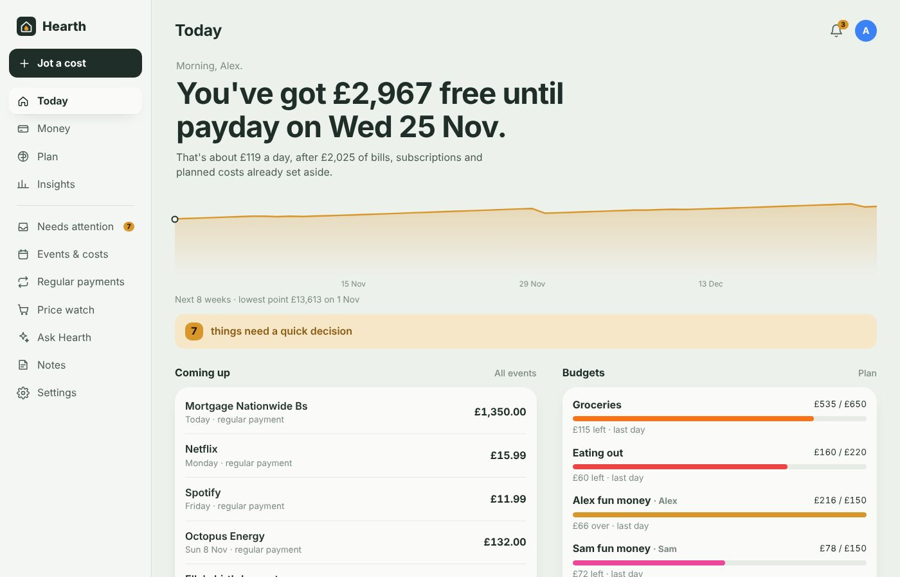
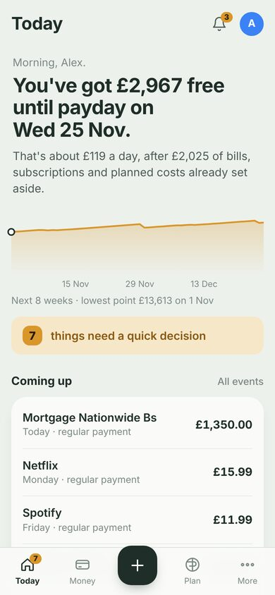
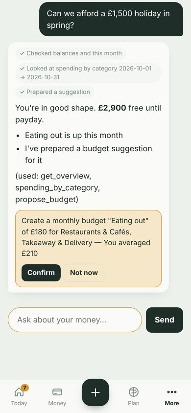
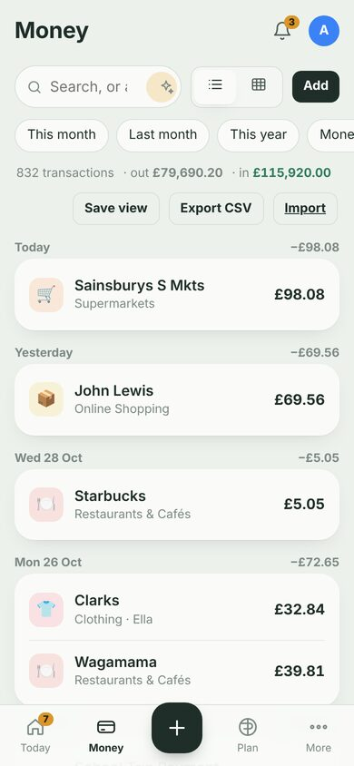

<b>Household money, handled.</b> 
A self-hosted finance manager for individuals and families that runs as a Home Assistant add-on, with a local AI that knows your numbers.

Hearth takes the admin of money out of your head. Transactions arrive from your bank, get cleaned up, categorised and checked against your budgets on their own. You only hear about the few things that genuinely need a decision.

Everything stays on your Home Assistant machine — transactions, budgets, calendar copies and AI conversations live in one local database that's included in your HA backups.

## What it does

| | |
|---|---|
| **Today** — one sentence answers "am I OK?" ("£2,913 free until payday on Fri 27 Nov"), with an 8-week balance forecast, what's due, budgets and goals. | **Needs attention** — the only list you have to look at. Every answer teaches Hearth, so it shrinks over time. |
| **Jot it down** — type `Ella's dentist £60 next Tue` or snap a receipt. Hearth works out the amount, date, category and person and files it. | **Ask Hearth** — chat with your own Ollama model. It looks up real figures and prepares budgets, goals and price watches you confirm with a tap. |
| **Spreadsheet power** — editable transaction grid, bulk edits, saved views, a year planner where actuals fill themselves in, pivot reports, CSV export. | **Forecasts** — next 8 weeks, 2 years and 5 years, built from your regular payments, seasonality, plans and event budgets. |
| **The whole household** — separate logins; budgets and targets that are shared, one person's own, or for the kids. | **Subscriptions & bills** — found automatically, separated from one-off purchases, price rises flagged. |
| **Calendars** — your HA calendars (Google, Outlook, Exchange…) with budgets and real costs on events. | **Home Assistant** — notifications to your phones, sensors for dashboards, events and service calls from workflows. |
| **Price watch** — PriceRunner or any shop; tells you when it's a good time to buy. | **Bank sync** — superFin / SimpleFIN or any JSON feed, plus CSV/OFX/QIF import for years of history. |

## Install

1. Click **Add repository** above, or in Home Assistant go to **Settings → Add-ons → Add-on Store → ⋮ → Repositories** and add `https://github.com/shotgn16/hearth`.
2. Find **Hearth** in the store and press **Install**. The first install builds on your device (a few minutes on a Raspberry Pi).
3. On the **Configuration** tab, enter your **Ollama address** and **Chat model**.
4. **Start** it, then open **Hearth** from the sidebar and create your household.

Then follow [Getting started](docs/getting-started.md).

Works on `amd64` and `aarch64` (Raspberry Pi 4/5, most mini PCs, HA Green/Yellow). Not using Home Assistant? See [Run it with Docker](docs/standalone-docker.md).

## Documentation

- [Getting started](docs/getting-started.md)
- [Connecting your bank and importing history](docs/bank-and-import.md)
- [Everyday use: Today, Needs attention, Jot, Money, Plan, Insights](docs/everyday-use.md)
- [Households: people, shared and individual budgets](docs/household.md)
- [Local AI (Ollama)](docs/local-ai.md)
- [Home Assistant integration](docs/home-assistant.md)
- [Workflows and notifications](docs/workflows.md)
- [Calendars and event costs](docs/calendars-and-events.md)
- [Price watch](docs/price-watch.md)
- [Run it with Docker (without Home Assistant)](docs/standalone-docker.md)
- [Privacy, security and backups](docs/privacy-and-security.md)
- [Troubleshooting & FAQ](docs/faq.md)
- [Development](docs/development.md)

## Privacy in one paragraph

Hearth has no cloud, no account with us and no telemetry. It only connects to the things you set up: your bank feed, your calendars, your Ollama server, Home Assistant, and shop pages for price watching (which receive only the product link). Read more in [Privacy, security and backups](docs/privacy-and-security.md).

## Licence

MIT — see [LICENSE](LICENSE).
