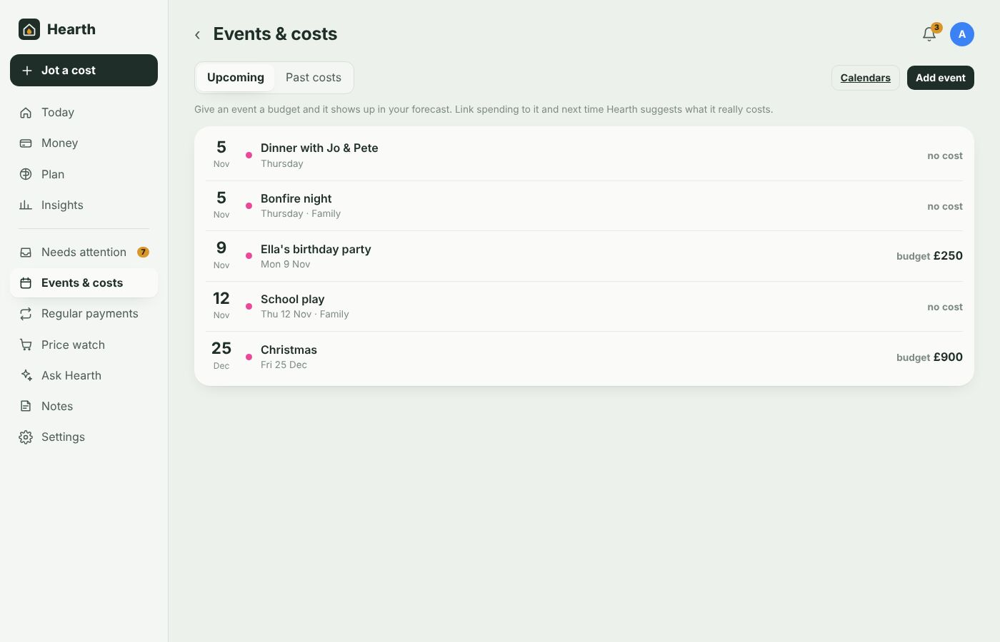

# Calendars and event costs

[← Documentation](../README.md#documentation)

Birthdays, holidays, school trips and weddings are where budgets usually go wrong. Hearth puts your calendars next to your money so you can plan for them and learn what they really cost.

## Bringing calendars in

**Settings → Calendars**

**From Home Assistant (recommended).** Every calendar entity you've connected to HA is listed — Google Calendar, Microsoft 365/Outlook/Exchange, CalDAV, local calendars. Tick to copy. This is the easiest way to get Exchange and Microsoft 365 calendars in, because HA handles the sign-in.

**From Microsoft 365 / Outlook.com.** If you've signed in with Microsoft under [Email receipts](email-receipts.md#outlookcom-hotmail-and-microsoft-365), each signed-in account is listed here — tick to keep a local copy of its calendar through Microsoft Graph. No published link needed, and private event details come through.

**By iCal link.** For calendars not in HA, choose the provider and paste the ICS link:

- **Google:** calendar.google.com → Settings → choose the calendar → *Integrate calendar* → *Secret address in iCal format*.
- **Outlook.com:** Settings → Calendar → Shared calendars → *Publish a calendar* → *Can view all details* → copy the ICS link.
- **Exchange / Microsoft 365:** Outlook on the web → Settings → Calendar → Shared calendars → *Publish a calendar*. For on-premises Exchange, publishing must be allowed by your admin.

Either way, Hearth keeps a **full local copy**: 3 years back and 2 years ahead, refreshed every hour, with recurring events expanded. Events you've attached a budget or cost to are kept even if they're later deleted in the source calendar.

## Events & costs

**More → Events & costs**

- **Upcoming** lists events with their budgets; **Past costs** lists past events that have spending linked to them.
- Tap an event to:
  - set a **budget** — it then appears in your forecast and Today's "free until payday" figure
  - see **spending around that day** and tap transactions to link them to the event
  - see **similar past events** and what they actually cost, with a suggested budget
  - **Estimate with AI** — an estimate, a range and a breakdown (venue, food, gifts, travel…) using your history where it exists
- **Add event** creates an event in Hearth only (handy for things not in any calendar).

Jotting `school trip £25 on 14/11` also creates a planned cost.

Upcoming events within two weeks with no budget show in Needs attention as "Will … cost anything?", so nothing sneaks up on you.

## How event spending is used

- **Forecast** — budgets and estimated costs are subtracted on the event's date.
- **Budgets** — a budget can be tied to one event.
- **Reports** — use *Event* as rows in **Insights → Reports** to see what each event cost.
- **Ask Hearth** — "What did Ella's last birthday party cost?" or "What's coming up in the next two weeks that will cost money?"

Next: [Price watch](price-watch.md)
