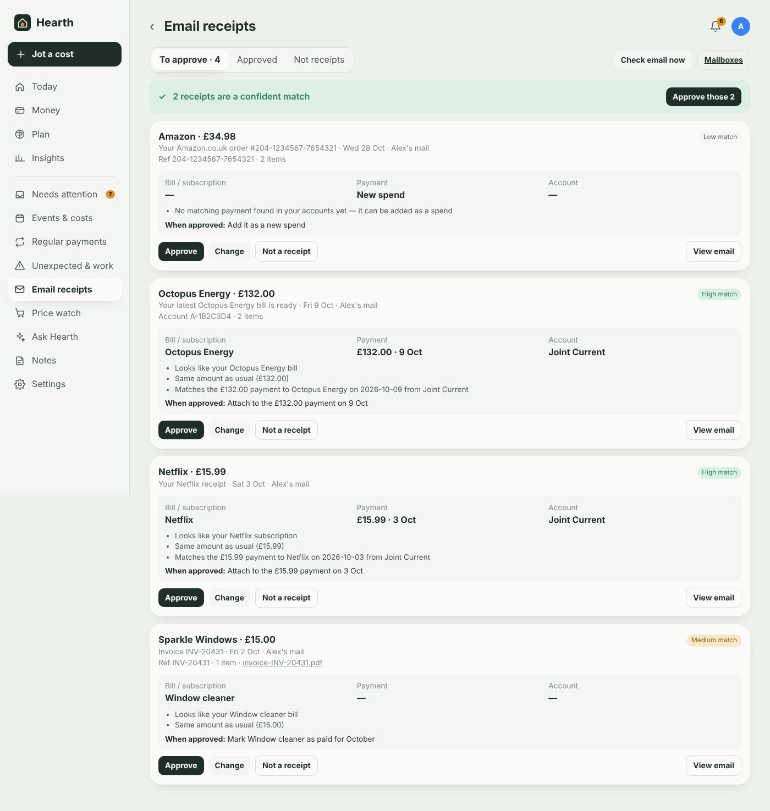
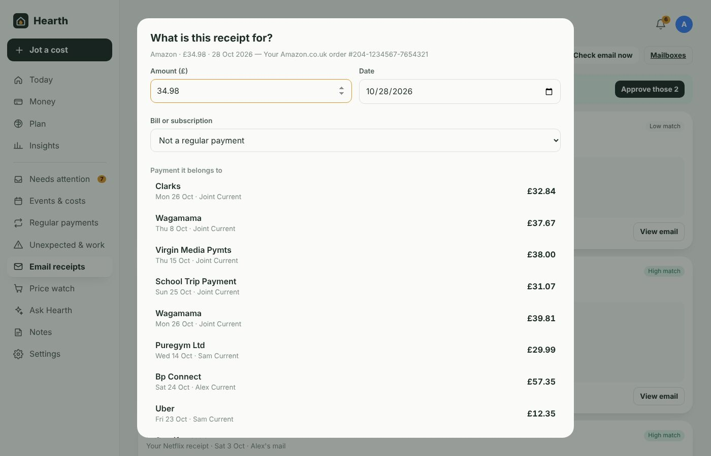
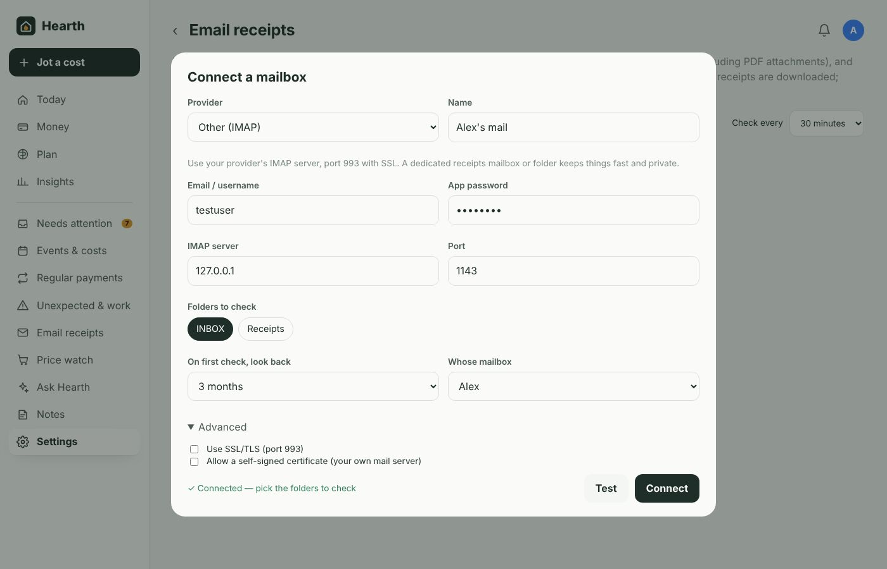

# Email receipts

[← Documentation](../README.md#documentation)

Hearth can watch your email for receipts, invoices and bills, work out which bill, payment and account each one belongs to, and file it — **but only after you approve it**.

## How it works

1. Every 30 minutes (you can change this) Hearth checks the mailboxes and folders you've chosen over IMAP.
2. It looks at subjects and senders first and only downloads emails that look like receipts, so newsletters and personal mail are skipped.
3. From each receipt it reads the shop or company, total, date, order/invoice number, account or customer number and line items — from the email itself, from **PDF attachments**, and from receipt photos if you've set a vision model. If the rule-based reader isn't sure, your local AI helps.
4. It works out:
   - **which bill or subscription** it is (by name, the usual amount, account numbers and senders you've filed before),
   - **which bank payment** it matches (same amount within a few days),
   - **which account** paid it,
   - **which month's payment** it is for, for bills and subscriptions.
5. It goes into **Email receipts → To approve** with a short explanation of why, and a High / Medium / Low match label. Nothing has changed yet.
6. You **Approve**, **Change** it first, or say it's **Not a receipt**.

## Approving

Each card shows what Hearth thinks the receipt is for and what will happen when you approve it:

| When approved | What happens |
|---|---|
| **Attach to the payment** | The receipt's details (reference and items) are added to that bank transaction, and the transaction is linked to the bill if it wasn't already. |
| **Mark the bill as paid** | For bills paid in a way Hearth can't see (cash, another card) — that month is ticked off in [Regular payments](regular-payments.md). |
| **Add it as a new spend** | Creates a transaction for it, in the account you choose. |
| **Just keep the receipt** | Stores it without changing anything else. |

When several receipts are a confident match, **Approve those N** approves them in one go — still your decision, just quicker.

Every approval teaches Hearth: the next email from that sender is suggested for the same bill and account.

Changed your mind? **Approved → Undo approval** puts it back in the queue and reverses what it did (a ticked-off payment goes back to automatic, an added spend is removed).

## Changing what it's matched to

**Change** lets you set:

- the amount and date (if the reader got them wrong),
- the bill or subscription (or "not a regular payment"),
- the bank payment, from the closest matches by amount and date — or "none of these",
- the account it was paid from,
- which payment it was for (for bills and subscriptions),
- what to do when approved.

Then **Approve**.

## Not a receipt

Removes it from the queue. You can also choose to ignore everything from that sender in future. If you dismiss something by mistake, **Not receipts → It is a receipt** brings it back.

## Connecting a mailbox

**Settings → Email receipts → Connect a mailbox**

Pick your provider, enter your email address and an **app password**, press **Test**, choose the folders to check, and **Connect**. Hearth looks back over the period you choose (3 months by default) the first time, then only at new mail.

| Provider | Server | Password |
|---|---|---|
| Gmail | `imap.gmail.com`, 993 | Turn on 2-Step Verification, then create an app password at myaccount.google.com/apppasswords |
| iCloud Mail | `imap.mail.me.com`, 993 | App-specific password from account.apple.com → Sign-In and Security |
| Yahoo Mail | `imap.mail.yahoo.com`, 993 | Account Security → Generate app password |
| Fastmail | `imap.fastmail.com`, 993 | Settings → Privacy & Security → Integrations |
| Your own server | your IMAP host, 993 | your mailbox password (there's an option for self-signed certificates) |
| Outlook.com / Microsoft 365 | — | Microsoft now requires its own OAuth sign-in for IMAP, which Hearth doesn't support yet. Set up an Outlook rule that **forwards receipts** to one of the mailboxes above (or a dedicated receipts mailbox) and connect that. |

**Tips**

- Checking a single **Receipts** folder or label (filled by a mail filter) is faster and more private than the whole inbox.
- A dedicated address like `receipts@yourdomain` that you forward bills to works well for families — connect it once for the whole household.
- Each household member can connect their own mailbox; everything lands in the same review queue.

## Where receipts show up

- **Money**: a transaction with an approved receipt shows it at the top of its detail, with links to any PDFs.
- **Regular payments**: bills ticked off from a receipt say so.
- **Needs attention**: "N email receipts to approve".
- **Ask Hearth**: "Which receipts are waiting?" or "Did the Octopus bill come through?".
- **Work expenses**: receipt items are included in the CSV you download for a claim.

## Privacy

Mail is read directly from your provider by the add-on and processed on your Home Assistant machine. Only emails that look like receipts are downloaded; their text and PDF/image attachments are stored in Hearth's data folder (and included in HA backups). If AI help is on, receipt text goes only to your own Ollama server. Mailbox passwords are stored in Hearth's database — use app passwords, which you can revoke at any time.

Next: [Unexpected costs and work expenses](unexpected-and-work.md)
