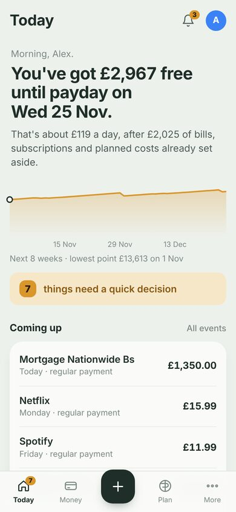
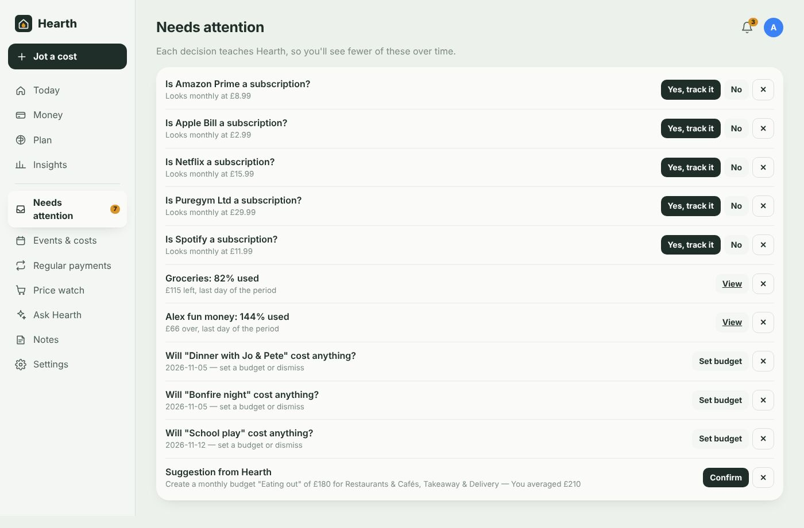
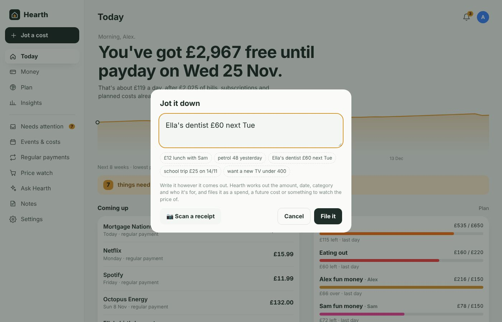
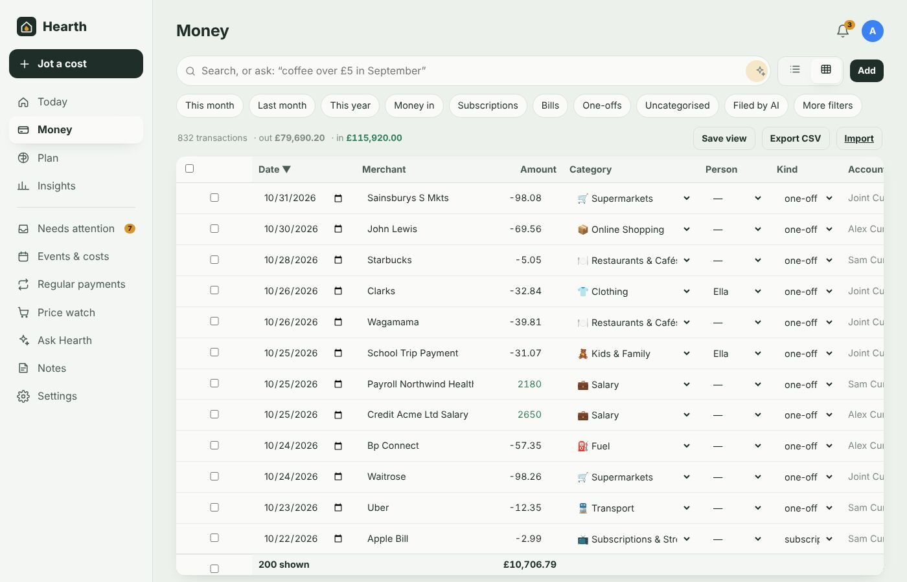
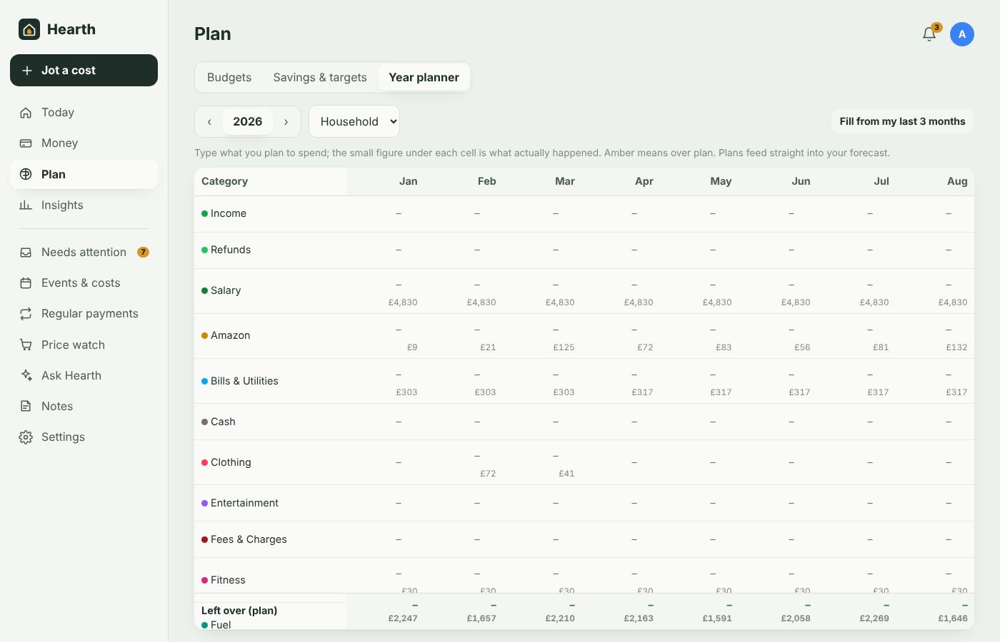
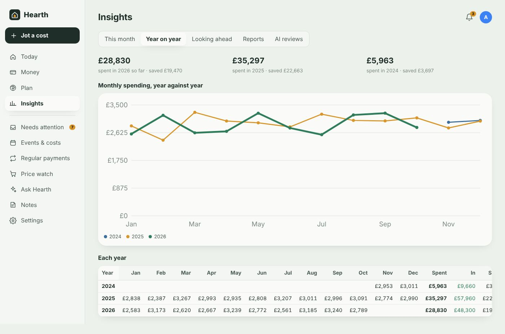

# Everyday use

[← Documentation](../README.md#documentation)

Hearth is built so that most days you only glance at **Today** and clear **Needs attention** when its badge appears. Everything else is there for when you want detail.

On phones the main screens are in the bottom bar, with **+** in the middle for jotting things down. On a computer they're in the left sidebar.

## Today

- **The headline** answers "am I OK?": how much is free to spend until your next payday, after bills, subscriptions and budgeted events already due before then. Payday is worked out from your salary payments.
- **The amber line** is your balance over the next 8 weeks; the dot marks the lowest point.
- **Needs attention** shows how many decisions are waiting — or a green "Nothing needs you right now".
- **Regular payments this month** shows how much has come out so far, what's still to go, anything late, and work expenses waiting to be claimed.
- **Coming up** lists regular payments and costed events in the next three weeks.
- **Worth knowing** surfaces anything unusual: a category running hot, a one-off spend far above normal for that shop, how this month compares with last.
- **Budgets, goals and accounts** at a glance.

The **bell** at the top shows everything Hearth has notified you about. The same messages also go to your phones through Home Assistant if you've set that up.

 

## Needs attention

The only list you have to deal with. Every item is a one-tap decision:

| Item | What to do |
|---|---|
| **What was …?** | Pick a category. Hearth applies it to every transaction from that merchant, past and future. |
| **Is … a subscription?** | *Yes, track it* or *No*. |
| **The AI filed N transactions** | *Review* to see them, *Looks right* to accept and teach Hearth those merchants. |
| **Budget … % used** | Open the budget. |
| **Will "event" cost anything?** | Set a budget, or dismiss. |
| **… hasn't come out** | A regular payment is late: *It's been paid* or *Skip this time*. |
| **… charged you after it ended** | Something you'd ended took money again — check it. |
| **Work expenses to claim** | Expenses waiting more than two weeks — go and claim them. |
| **Check this note** | Fix the amount/date/category of something you jotted. |
| **Suggestion from Hearth** | Confirm a suggestion the AI prepared. |

Dismiss anything with ✕.

## Jot it down (+)

Type it the way you'd say it. Examples:

| You type | Hearth files |
|---|---|
| `£12 lunch with Sam` | A £12 spend today, Restaurants & Cafés, for Sam |
| `petrol 48 yesterday` | £48 Fuel, yesterday |
| `Ella's dentist £60 next Tue` | A planned £60 cost on next Tuesday's calendar, for Ella (shows in your forecast) |
| `school trip £25 on 14/11` | A planned £25 cost on 14 November |
| `want a new TV under 400` | A price watch with a £400 target |

If something's unclear, Hearth asks your local AI; if it still isn't sure, the note waits in Needs attention with the fields filled in for you to check.

**Scan a receipt** (when a vision model is set): take a photo, and Hearth reads the shop, date, total and items. If your bank has already sent that payment, the items are added to it instead of creating a duplicate.

## Money

All your transactions, as a list (phones) or an editable grid (computers) — switch with the two icons next to the search box.

- **Search** matches merchant, description and notes. Type a question instead — *coffee over £5 in September*, *Sam's Amazon orders this year* — and press **Enter**: your local AI turns it into filters.
- **Quick filters**: this month, last month, this year, money in, subscriptions, bills, one-offs, uncategorised, unexpected, work expenses, filed by AI, plus your saved views. **More filters** for dates, category, account, person, user, tag, direction.
- **Grid view**: edit date, merchant, amount, category, person, kind and notes in place; click a header to sort; tick rows to bulk-set category, person, tag, kind or colour, or delete.
- **Save view** keeps the current filters as a chip. **Export CSV** downloads exactly what you're looking at.
- Tap a transaction for the full detail: category (with "use this for every transaction from …"), who it was for, which event it belongs to, kind (one-off / subscription / bill), merchant name, colour, notes, tags, and switches for **Unexpected cost** and **Work expense** (with its claim stage).

## Plan

**Budgets** — weekly, monthly, quarterly, yearly or custom dates, across any categories (or all spending), shared or individual. **Count** can limit a budget to only unexpected costs, leave them out, or count only work expenses. A warning threshold (80% by default) triggers a notification; projected end-of-period spend shows whether you're on track. **Suggest some** asks the AI for budgets based on your last six months.

**Savings & targets** — a target amount and optional date; Hearth shows the monthly amount needed. **Add money** records contributions.

**Year planner** — the spreadsheet you'd normally keep:

Categories down, months across. Type what you plan to spend; the small figure underneath is what actually happened (amber when over). The bottom row shows planned money left over each month. **Fill from my last 3 months** fills empty future months from your averages. Switch between the household and each user. Plans feed straight into the forecast. Enter moves down, like a spreadsheet.

## Insights

- **This month** — spending by category, notes on anything unusual, top places over 90 days, the last 12 months of money in and out.
- **Year on year** — each year's monthly spending on one chart, plus totals and savings per year.

- **Looking ahead** — balance forecast for the next 8 weeks (daily), 2 years (monthly) and 5 years, with a month-by-month table. Built from regular payments on their real dates, seasonal patterns from previous years, typical income, your year planner and event budgets.
- **Reports** — a pivot table: choose rows and columns from category, merchant, person, user, account, event, kind, day, week, month, year or weekday; show spending, income, net, count or average; filter by dates and user; download CSV.
- **AI reviews** — monthly reviews written by your local model.

## Regular payments, unexpected costs and work expenses

These have their own pages:

- [Regular payments](regular-payments.md) — the subscription and bill tracker: what's due, what's come out, payment dates, history.
- [Unexpected costs and work expenses](unexpected-and-work.md) — flag unplanned costs, track expenses to claim back.

Next: [Regular payments](regular-payments.md)
