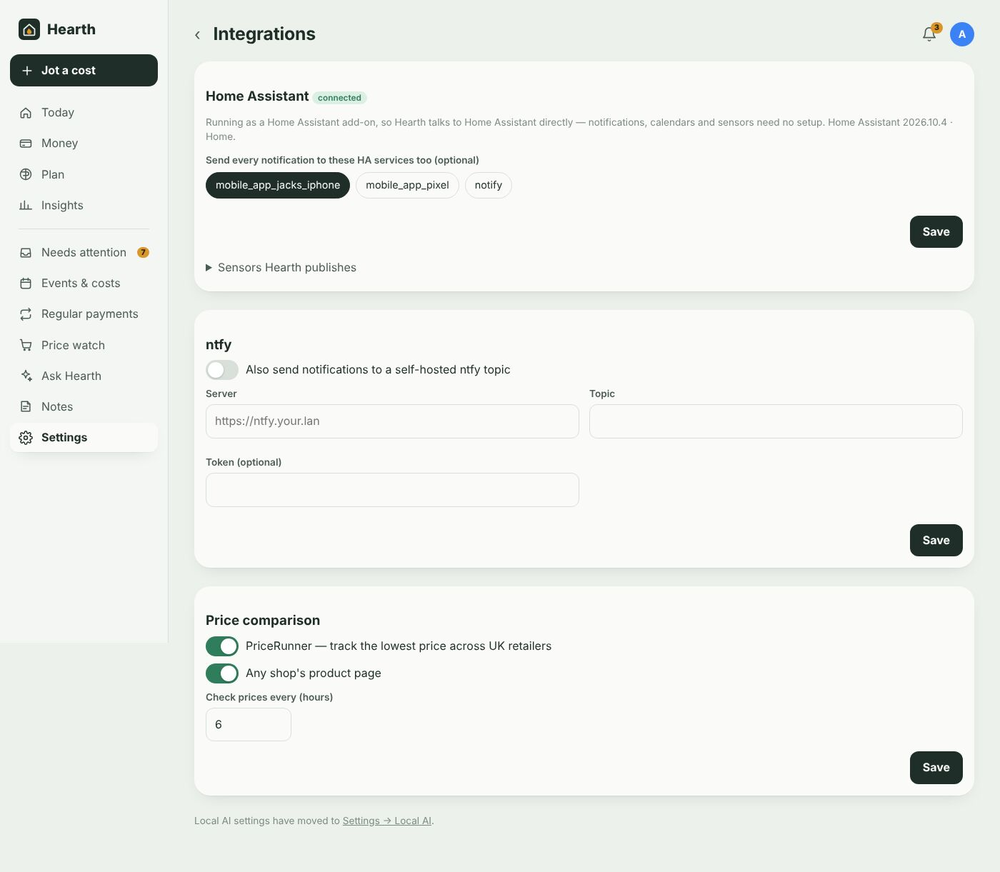
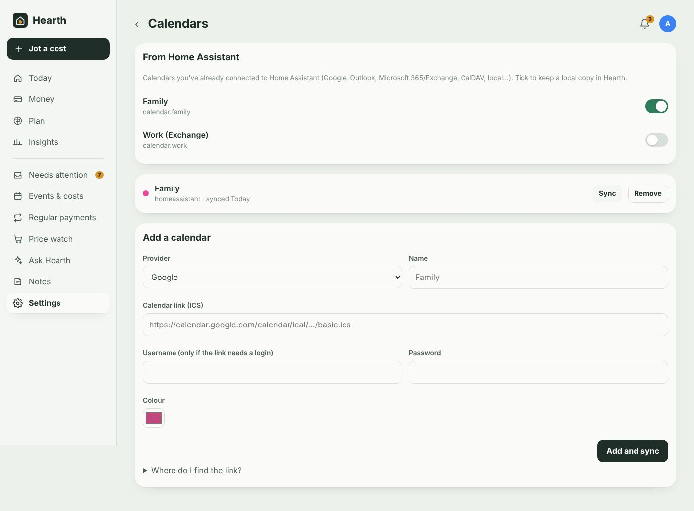

# Home Assistant integration

[← Documentation](../README.md#documentation)

Because Hearth runs as an add-on, it talks to Home Assistant directly through the Supervisor — there are no URLs or tokens to paste. **Settings → Integrations** shows the connection and your HA version.



## Sidebar panel and sign-in

Hearth appears in the HA sidebar and in the HA app on every phone. The panel identifies you from your Home Assistant login: the first time, you sign in to Hearth once to link the two; after that it opens straight in. (Turn on **Let any Home Assistant user in** in the add-on options to give every HA user their own Hearth login automatically.)

Hearth only trusts HA's identity information when the request really comes through Home Assistant's ingress proxy.

## Notifications to your phones

Hearth sends notifications through your HA **notify services** — for phones with the Home Assistant app these are `notify.mobile_app_<phone name>`. Tapping one opens Hearth's panel.

- **Settings → Integrations → Send every notification to these HA services too** — pick which phones (or other notify services) receive *all* of Hearth's notifications: budget alerts, the morning summary, new subscriptions and price rises, price drops, monthly reviews.
- **Workflows** can send to specific services instead — e.g. only Sam's phone when Amazon spending goes over £100. See [Workflows](workflows.md).

Everything also appears under the bell in Hearth.

## Calendars



**Settings → Calendars → From Home Assistant** lists every calendar entity in HA — Google Calendar, Microsoft 365/Outlook/Exchange, CalDAV, local calendars — tick the ones to copy. Hearth keeps a local copy (3 years back, 2 years ahead), refreshed hourly. See [Calendars and event costs](calendars-and-events.md).

## Sensors

With **Publish sensors** on (add-on options), Hearth updates these entities every 15 minutes:

| Entity | State | Attributes |
|---|---|---|
| `sensor.hearth_free_to_spend` | Money free until payday after commitments | `payday`, `until`, `committed` |
| `sensor.hearth_spent_this_month` | Spending so far this month | |
| `sensor.hearth_balance` | Total across accounts | |
| `sensor.hearth_needs_attention` | Items waiting in Needs attention | |
| `sensor.hearth_next_payment` | Date of the next regular payment | `merchant`, `amount` |

Money sensors use the `monetary` device class in GBP.

These are created through HA's state API, so they don't have unique IDs (you can't rename them in the UI) and they reappear when Hearth next updates after an HA restart.

### Dashboard card example

```yaml
type: entities
title: Money
entities:
  - entity: sensor.hearth_free_to_spend
    name: Free until payday
  - entity: sensor.hearth_spent_this_month
    name: Spent this month
  - entity: sensor.hearth_next_payment
    name: Next payment
  - entity: sensor.hearth_needs_attention
    name: Things to check
```

## Workflows that drive Home Assistant

Two workflow actions reach into HA:

- **Fire a Home Assistant event** — e.g. `hearth_big_spend`. Event data includes `rule`, `merchant`, `amount`, `category_id`, `date`, and for budget triggers `name` and `pct`.
- **Call a Home Assistant service** — any service with JSON data; `{merchant}` and `{amount}` are filled in. E.g. `light.turn_on` with `{"entity_id":"light.hallway","color_name":"orange","flash":"short"}`.

### Automation examples

Announce big spends on a speaker:

```yaml
alias: Announce big spends
triggers:
  - trigger: event
    event_type: hearth_big_spend
actions:
  - action: tts.speak
    target:
      entity_id: tts.piper
    data:
      media_player_entity_id: media_player.kitchen
      message: >
        Heads up: {{ trigger.event.data.merchant }} just took
        £{{ (trigger.event.data.amount | abs) | round(0) }}
```

Turn a light amber when free-to-spend drops under £200:

```yaml
alias: Low money light
triggers:
  - trigger: numeric_state
    entity_id: sensor.hearth_free_to_spend
    below: 200
actions:
  - action: light.turn_on
    target:
      entity_id: light.hallway
    data:
      color_name: orange
```

Remind you the evening before a regular payment:

```yaml
alias: Payment tomorrow
triggers:
  - trigger: time
    at: "19:00:00"
conditions:
  - condition: template
    value_template: >
      {{ states('sensor.hearth_next_payment') == (now() + timedelta(days=1)).strftime('%Y-%m-%d') }}
actions:
  - action: notify.mobile_app_jacks_iphone
    data:
      message: >
        {{ state_attr('sensor.hearth_next_payment','merchant') }} takes
        £{{ state_attr('sensor.hearth_next_payment','amount') }} tomorrow
```

## Backups

Hearth's database lives in the add-on's own storage and is included in Home Assistant backups. Just before each backup Hearth flushes its write-ahead log so the copy is consistent.

## Permissions the add-on asks for

| Permission | Why |
|---|---|
| `ingress` | The sidebar panel |
| `homeassistant_api` | Notify services, calendars, sensors, events and service calls |
| `hassio_api` (default role) | Reads its own add-on info so phone notifications can open the panel |

Next: [Workflows](workflows.md)
