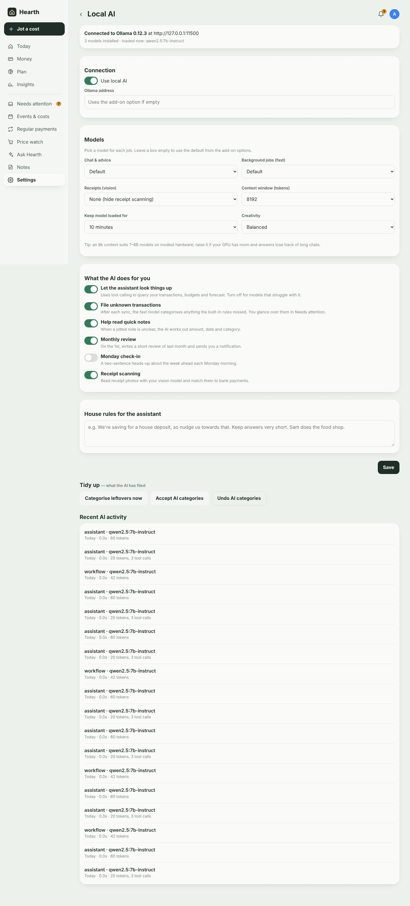
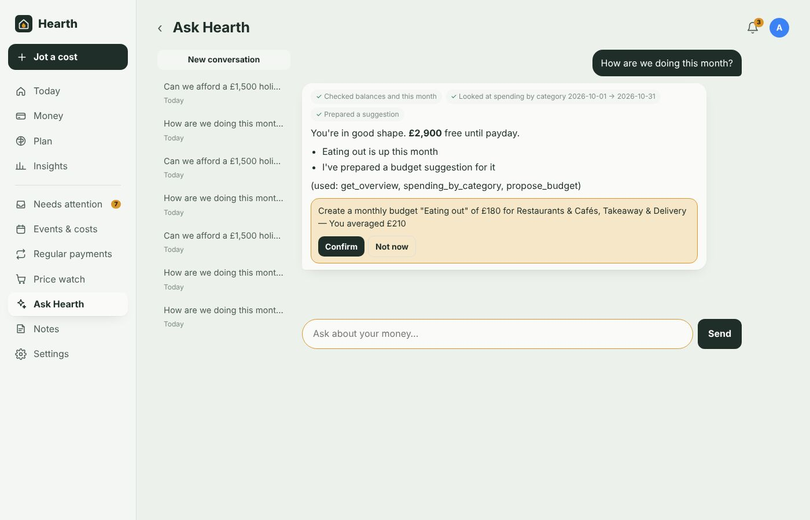

# Local AI (Ollama)

[← Documentation](../README.md#documentation)

Hearth uses your own [Ollama](https://ollama.com) server. Prompts and your financial data go from the add-on to that server and nowhere else.

## Setting it up

1. Make sure Ollama listens on your network. On the machine running it, set `OLLAMA_HOST=0.0.0.0` (for the Linux service: `sudo systemctl edit ollama`, add `Environment="OLLAMA_HOST=0.0.0.0"` under `[Service]`, then restart).
2. In the add-on's **Configuration**, set **Ollama address** to `http://<that machine's IP>:11434` and **Chat model** to a model you've pulled.
3. Open **Settings → Local AI** in Hearth. The top card shows whether Ollama is reachable, its version, the installed models and which are loaded right now.

## Choosing models

Hearth uses up to three models, each for the job it's best at:

| Job | Used for | Good choices |
|---|---|---|
| **Chat & advice** | Ask Hearth, monthly reviews, budget suggestions, subscription review, event estimates, workflow drafts | `qwen2.5:7b-instruct`, `qwen3:8b`, `llama3.1:8b` |
| **Background jobs (fast)** | Categorising new transactions, reading notes, smart search, check-ins | `qwen2.5:3b-instruct`, `llama3.2:3b` — or leave as the chat model |
| **Receipts (vision)** | Reading receipt photos | `qwen2.5vl:7b`, `llama3.2-vision`, `minicpm-v` |

Other settings:

- **Context window** — 8,192 tokens suits 7–8B models on modest hardware. Raise it if your GPU has room and long conversations lose track.
- **Keep model loaded for** — how long Ollama keeps the model in memory after a request. Longer = faster replies, more memory held.
- **Creativity** — *Precise* for the most factual answers; *Balanced* by default.
- **House rules** — free text added to every conversation, e.g. *We're saving for a house deposit, so nudge us towards that. Keep answers very short. Sam does the food shop.*

## Ask Hearth

A chat with your model that **looks things up instead of guessing**. Each lookup appears as a small tick above the answer, so you can see where the numbers came from.

What it can look up:

- balances, money free until payday, spending so far this month
- spending by category for any dates, optionally for one user or person
- individual transactions by text, category, dates or amount
- two periods compared, by category or merchant
- monthly income and spending trends
- the full history at one shop
- budgets (with projected end-of-period spend), savings goals, subscriptions and bills, the forecast
- upcoming events, and what similar past events actually cost
- price watches, and whether a purchase is affordable right now (free money, the relevant budget, impact on goals, similar past purchases)

When a next step would help, it **prepares a suggestion card**. Nothing changes until you tap **Confirm**:

- create a budget
- set up a savings goal
- watch a product's price
- put a budget on a calendar event
- add a planned future cost (so it's in the forecast)
- move every transaction from a merchant to a different category
- remind you to cancel a subscription a few days before it renews

The same suggestion is never stacked up twice; unconfirmed suggestions also wait in Needs attention for two weeks.

Conversations are saved (the list is on the left on wide screens) so you can come back to them. Answers stream in as they're written.

**Things to try**

- *How are we doing this month?*
- *Where could we cut back without really noticing?*
- *Can we afford a £1,500 holiday in the spring?*
- *Should I buy a Dyson V15 for £550 now or wait? Where's cheapest?*
- *What did we spend on eating out this year compared with last?*
- *What's coming up in the next two weeks that will cost money?*
- *How much has Ella cost us since September?*

**Quick tools** on the Ask screen: write last month's review, suggest budgets, check my subscriptions, "Should I buy…?", scan a receipt.

### If your model can't use tools

Looking things up needs a model with tool-calling support. If yours doesn't have it, Hearth notices automatically, shows a short notice, and answers from a summary of your data instead (this month by category, 12-month trend, budgets, goals, subscriptions, upcoming events, forecast). You can also switch looking-up off under **What the AI does for you**.

## What the AI does in the background

Each can be switched off under **Settings → Local AI → What the AI does for you**.

| Feature | What happens |
|---|---|
| **File unknown transactions** | After each bank sync or import, the fast model categorises anything the built-in rules and your past corrections didn't cover, using your own past decisions as examples and skipping anything it's unsure about. These show in Needs attention as "The AI filed N transactions". **Looks right** teaches Hearth those merchants permanently. |
| **Help read quick notes** | When a jotted note is ambiguous, the AI works out the amount, date, category and person. |
| **Monthly review** | On the 1st (after your morning summary time) it writes a short review of the previous month — how it compared with last month and last year, what drove it, budgets, goals, anything new — and notifies you. All reviews live under **Insights → AI reviews**, where you can also write one for any month. |
| **Monday check-in** | A two-sentence heads-up about the week ahead. Off by default. |
| **Receipt scanning** | Reads receipt photos with the vision model and matches them to bank payments within four days by amount. |

## AI elsewhere in the app

- **Money → search**: type a question and press Enter.
- **Plan → Budgets → Suggest some**.
- **Regular payments → Ask AI what to cut**.
- **Events → Estimate with AI**: an estimate, a low–high range and a breakdown, using what similar past events actually cost you.
- **Settings → Workflows → Describe it**: "ping my phone when we spend over £100 at Amazon" becomes a draft workflow to check and save.

## Keeping an eye on it

- **Settings → Local AI → Recent AI activity** lists every AI job, the model used, how long it took and any error.
- **Tidy up**: run categorising now, accept all AI categories, or undo every AI category you haven't accepted.
- **Money → Filed by AI** shows exactly which transactions the AI categorised.

## Hardware notes

- A 7–8B model needs about 6–8 GB of GPU memory (or runs slowly on CPU). A 3B fast model needs about 3 GB.
- The first request after the model has been unloaded takes longer while it loads; *Keep model loaded for* helps.
- Background jobs run one at a time and never block the app.

Next: [Home Assistant integration](home-assistant.md)
