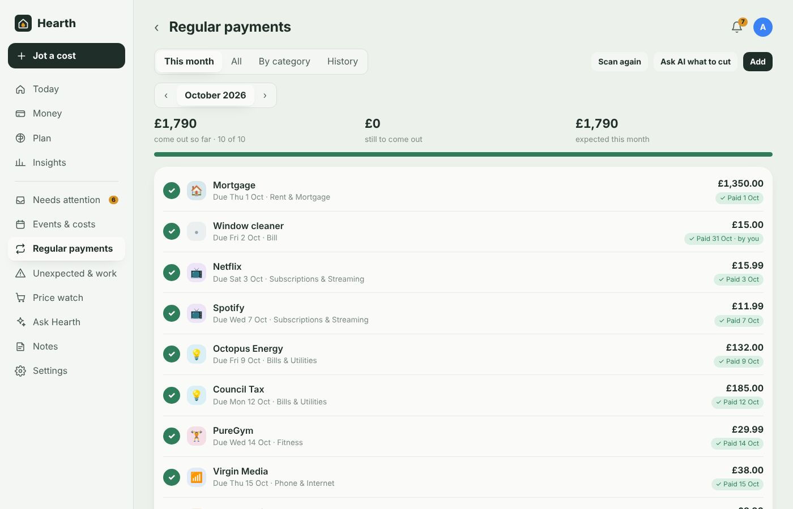
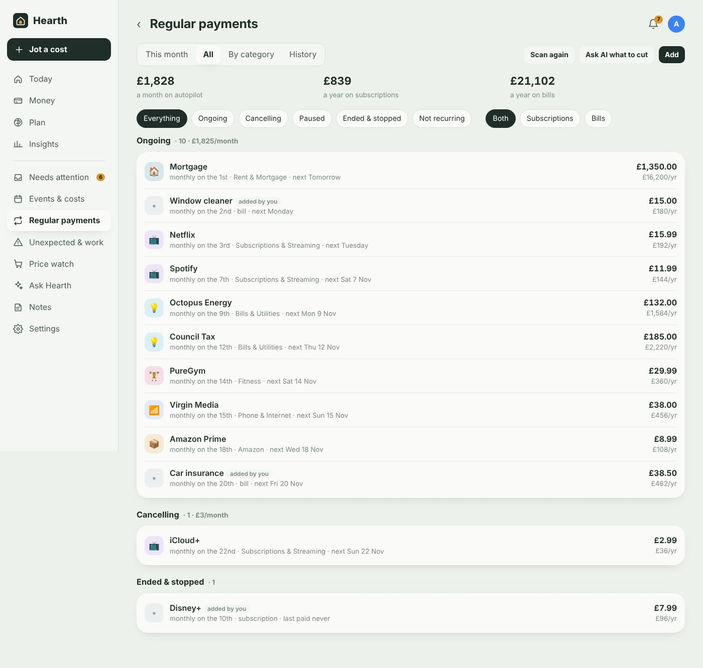
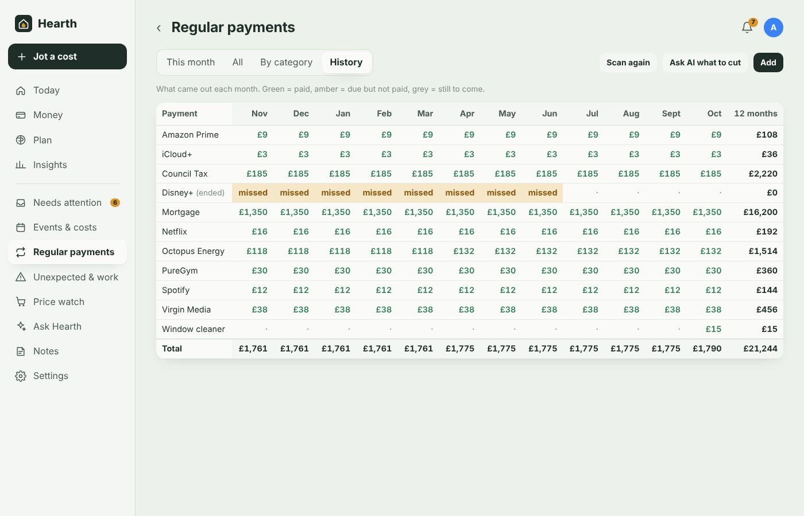

# Regular payments: the subscription and bill tracker

[← Documentation](../README.md#documentation)

**Regular payments** (under **More** on phones) keeps track of every subscription and bill: when each one is due, whether it has come out this month, and what you've paid over time.

Hearth finds most of them on its own from your bank transactions (anything that repeats weekly, fortnightly, monthly, quarterly or yearly at a steady amount) and splits them into **subscriptions** and **bills**. You can add anything it hasn't spotted.

## This month

A checklist of everything due in the month, in date order:

- **Come out so far / still to come out / late / expected** at the top, with a progress bar.
- Each payment shows its due date and a status: **✓ Paid** (with the date it came out), **Due today**, **in N days**, **N days late**, or **Skipped**.
- Payments are **ticked off automatically** when the matching transaction arrives from your bank.
- **Tap the circle** to mark one paid yourself — handy for cash, a card Hearth can't see, or a payment from someone else's account. Tap again to **skip** it this month (a free month, a payment holiday), and again to go back to automatic.
- Use **‹ ›** to look at previous or future months.

If something is two days late, Hearth tells you (bell, and your phones via Home Assistant) and adds it to **Needs attention** with **It's been paid** and **Skip this time** buttons.

## Setting the payment date

Open a payment and press **Edit details & payment date**. Set the **day of the month** it's due (e.g. 15). Hearth then:

- shows it on that day in **This month**, and works out when it's late,
- uses it for the forecast, Today's "free until payday" figure and the 3-day reminder workflow trigger.

Without a payment date, Hearth uses the day it last came out.

## Ongoing, cancelling, paused and ended

**All** groups everything by status, with filters for status and for subscriptions vs bills:

| Status | Meaning |
|---|---|
| **Ongoing** | Paying as normal. |
| **Cancelling** | You've cancelled, but there's still a payment to go. It stays in the checklist until you mark it ended. |
| **Paused** | On hold — left out of the checklist and forecast. |
| **Ended & stopped** | You marked it ended (with the date), or Hearth noticed it stopped. Shows the **last payment** and its amount. |
| **Not recurring** | It isn't really a regular payment; its transactions go back to being one-offs. |

Change status from the buttons at the top of a payment's detail. If something you've ended **charges you again**, Hearth flags it straight away — useful for catching subscriptions that didn't actually cancel.

Each payment's detail also shows the total you've paid, when it started, its payment history and any notes (a good place for account numbers or how to cancel).

## By category

What each kind of regular payment costs per month and year — streaming, utilities, insurance, phone and internet, fitness and so on.

## History

The spreadsheet you'd otherwise keep: every payment down the side, the last 12 months across the top. Green shows what came out, amber marks a month where something was due but didn't come out, grey is still to come. Totals for each month and for the year.

## Adding one yourself

Press **Add** for anything Hearth hasn't spotted: a new subscription before its first payment, the window cleaner, something paid from an account that isn't connected.

You set the name, amount, how often, payment day, type (subscription or bill), category, which account pays it, whose it is, and when it started. Optionally give the text to look for in bank payments (otherwise the name is used); matching transactions are linked automatically from then on.

## Other places it shows up

- **Today** shows how much of this month's regular payments has come out, what's still to go and anything late.
- **Ask Hearth** can answer "What's still to come out this month?" or "Has the council tax gone out yet?".
- **Ask AI what to cut** reviews them for overlaps and better deals, and can set a reminder to cancel before the next renewal.
- **Workflows** can react when a new subscription is spotted or a payment is due in 3 days.
- [Email receipts](email-receipts.md) for bills can tick off a month when the bill was paid somewhere Hearth can't see.
- The `sensor.hearth_next_payment` entity in Home Assistant shows the next one due.

Next: [Email receipts](email-receipts.md)
