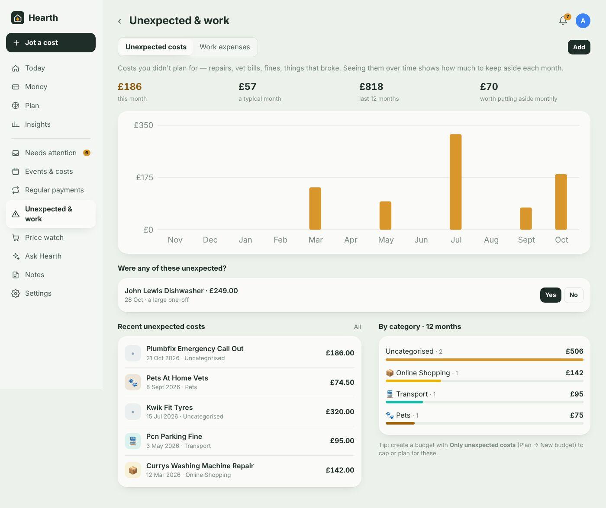
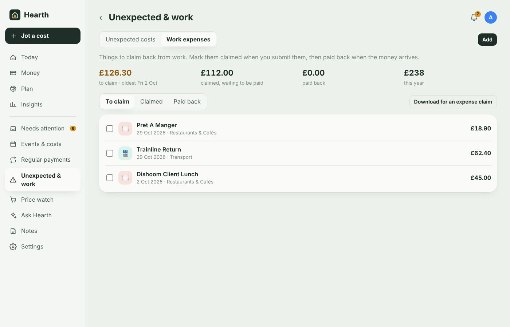

# Unexpected costs and work expenses

[← Documentation](../README.md#documentation)

**More → Unexpected & work** tracks two kinds of spending that usually live in a separate spreadsheet: costs you didn't plan for, and things you need to claim back from work.

## Unexpected costs

Repairs, vet bills, fines, things that broke. Flag them and Hearth shows:

- **this month**, **a typical month**, the **last 12 months**, and **how much is worth putting aside monthly** to cover them,
- a chart of unexpected costs per month, and a breakdown by category,
- the list of flagged costs.

**Flagging a cost**

- Open any transaction and switch on **Unexpected cost**.
- Answer **Were any of these unexpected?** — Hearth suggests recent one-offs that are big for you or far above what you usually spend at that place.
- Jot it: `emergency plumber £180`, `car repair 320 yesterday` — words like *emergency*, *repair*, *broke*, *replacement*, *vet* flag it automatically.
- Use **Add** for something not in your transactions yet.
- Or let a [workflow](workflows.md) do it with the **Mark as unexpected cost** action.

**Budgeting for them:** create a budget and set **Count** to **Only unexpected costs** — e.g. £150 a month for the unexpected. Or choose **Leave out unexpected costs** so a one-off repair doesn't blow your normal budgets.

## Work expenses

Things to claim back, tracked through three stages: **To claim → Claimed → Paid back**.

- The top shows how much is **to claim** (and how old the oldest item is), **claimed and waiting to be paid**, **paid back**, and the total this year.
- **Tick items** and press **Mark claimed** when you submit a claim (you can add the claim reference), then **Mark paid back** when the money arrives.
- When marking paid back, pick the incoming payment from your employer if it's in a connected account. Hearth files it under *Work expenses repaid*, so it doesn't count as income.
- **Download for an expense claim** exports the items in the current stage as a CSV with dates, merchants, amounts, categories and notes. Scanned receipts add their items to the notes.

**Marking something as a work expense**

- Open any transaction and switch on **Work expense** (its stage can be changed there too).
- Jot it: `£45 client lunch`, `train to Leeds for work £62` — *work*, *client*, *business*, *expenses*, *claim*, *mileage* mark it automatically.
- Use **Add** for something paid in a way Hearth can't see.
- Or use the **Mark as work expense** workflow action — e.g. everything from `trainline` on weekdays.

If work expenses have been waiting to be claimed for more than two weeks, a reminder appears in **Needs attention**.

## Finding them elsewhere

- **Money** has **Unexpected** and **Work expenses** quick filters, and labels on each transaction.
- **Reports** and CSV exports include the unexpected flag and claim stage.
- **Ask Hearth** can answer "How much have unexpected costs been this year?" or "What work expenses haven't I claimed?".

Next: [Households](household.md)
