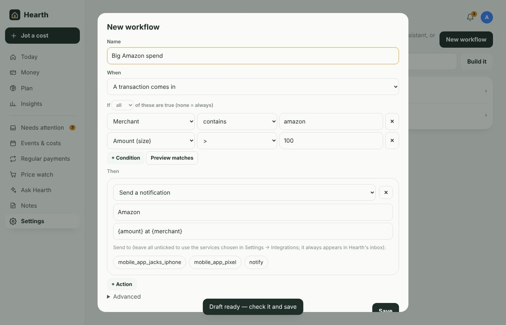

# Workflows and notifications

[← Documentation](../README.md#documentation)

A workflow is **when** something happens, **if** some conditions are true, **then** do these things. They run on their own in the background.

**Settings → Workflows**

## Building one

The fastest way is to describe it: type into **Describe it** — *"ping my phone when we spend over £100 at Amazon"* — and press **Build it**. Your local AI drafts the workflow; check it and **Save**.

Or press **New workflow** and fill it in yourself. **Preview matches** shows how many existing transactions the conditions would catch, with examples. For transaction workflows, **Apply to past transactions** runs it over your history (notifications are skipped when doing this).

## Triggers

| When | Useful fields in conditions |
|---|---|
| A transaction comes in | merchant, description, amount, direction, category, account, person, user, kind, weekday, day of month |
| A large transaction comes in (over the amount in **Settings → Your data**, £250 by default) | same as above |
| A budget reaches its warning level (and again at 100%) | budget % used |
| A new subscription is spotted | merchant, amount |
| A regular payment is due in 3 days | merchant, amount, days until |
| A calendar event is within a week | event title (as merchant), budget, days until |
| A watched price hits its target or a new low | price |

## Conditions

Choose **all** or **any**. Operators: contains, doesn't contain, is, is not, starts with, matches pattern (regular expression), greater/less than, between (`10,50`), one of (`a,b,c`), is empty. No conditions = always.

## Actions

| Action | Notes |
|---|---|
| Set category | Optionally "remember for this merchant" so future ones follow without the workflow |
| Add tag | Creates the tag if it doesn't exist |
| Assign to person | |
| Mark as | one-off, subscription or bill |
| Colour it | Shows as a stripe on the transaction |
| Rename merchant | |
| Add a note | `{merchant}`, `{amount}` are filled in |
| Send a notification | Title and message (use `{amount}`, `{merchant}`, `{name}`, `{pct}`). Pick which Home Assistant notify services receive it; leave all unticked to use the ones chosen in **Settings → Integrations**. It always appears under the bell in Hearth, and goes to ntfy if that's switched on. |
| Fire a Home Assistant event | For HA automations — see [Home Assistant](home-assistant.md#workflows-that-drive-home-assistant) |
| Call a Home Assistant service | Any service with JSON data |

Under **Advanced**: the order workflows run in, and "stop other workflows after this one".

## Recipes

- **Tag everything for the kids** — *A transaction comes in*, merchant matches pattern `smyths|clarks|school` → add tag *Kids*, assign to person *Ella*.
- **Work expenses** — merchant contains `trainline`, weekday between `1,5` → add tag *Work*, colour it blue.
- **Big spend alert to one phone** — *A large transaction comes in*, direction is `out` → notify `mobile_app_jacks_iphone` "{amount} at {merchant}".
- **Groceries budget nearly gone** — *A budget reaches its warning level*, budget % used ≥ 90 → call `light.turn_on` on the kitchen light in orange.
- **Before a subscription renews** — *A regular payment is due in 3 days*, merchant is `Netflix` → notify "Netflix renews in {days_until} days".

## Notifications Hearth sends by itself

Unless a workflow handles the same trigger, Hearth notifies you about: budgets reaching their warning level and 100%, new subscriptions, subscription price changes, watched prices hitting target or a new low, the morning summary (payments due soon, costed events this week, things to check — time set in **Settings → Your data**), and monthly AI reviews.

They go to Hearth's bell, the HA notify services chosen in **Settings → Integrations**, and ntfy if enabled.

Next: [Calendars and event costs](calendars-and-events.md)
